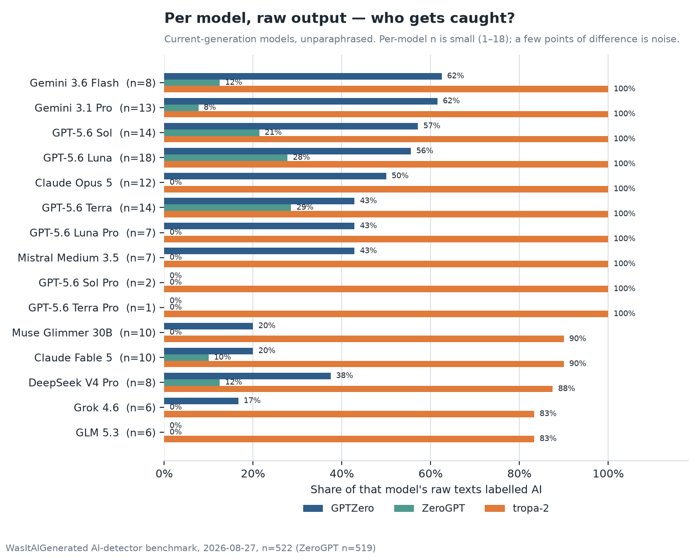

# August 2026 edition: GPTZero, ZeroGPT and tropa-2 on current LLMs

Open benchmark for AI text detectors. 522 English texts (251 human, 271 LLM-generated), each scored
on the same day by **GPTZero**, **ZeroGPT** and **tropa-2**, the
[WasItAIGenerated](https://wasitaigenerated.com) detector.

Full write-up, charts and FAQ:
**https://wasitaigenerated.com/research/ai-detector-benchmark-gptzero-zerogpt-tropa-2-2026**

## Headline results

Share of texts labelled AI. Human row = false-positive rate (lower is better); other rows = detection
rate (higher is better). ZeroGPT returned nothing for 3 texts, so its column is over 519.

| Category                    |   n | GPTZero | ZeroGPT | tropa-2 |
|-----------------------------|----:|--------:|--------:|--------:|
| Human (false positives)     | 251 |   0.0 % |   2.8 % |   0.4 % |
| AI, all                     | 271 |  47.2 % |  23.4 % |  93.4 % |
| Current models, raw         | 136 |  41.9 % |  11.8 % |  96.3 % |
| Current models, paraphrase  |  50 |   2.0 % |   2.1 % |  74.0 % |
| Previous models, raw        |  50 |   100 % |  90.0 % |   100 % |
| Previous models, paraphrase |  35 |  57.1 % |   2.9 % |   100 % |

**Read the caveat before quoting anything:** the AI texts come from the WasItAIGenerated generation
pipeline, so this sits closer to tropa-2's training distribution than to GPTZero's or ZeroGPT's.
Treat tropa-2's numbers as an upper bound and the others as cold-start results on an unfamiliar
distribution. All limitations are listed in the write-up.

## Data

The row-level data for this edition is not published here. The [September 2026 edition](../2026-09/)
repeats the comparison on 2,572 texts with Pangram added, and publishes every text and verdict, so use
that one to reproduce or extend the results. The charts from the write-up are in [`charts/`](charts/).
